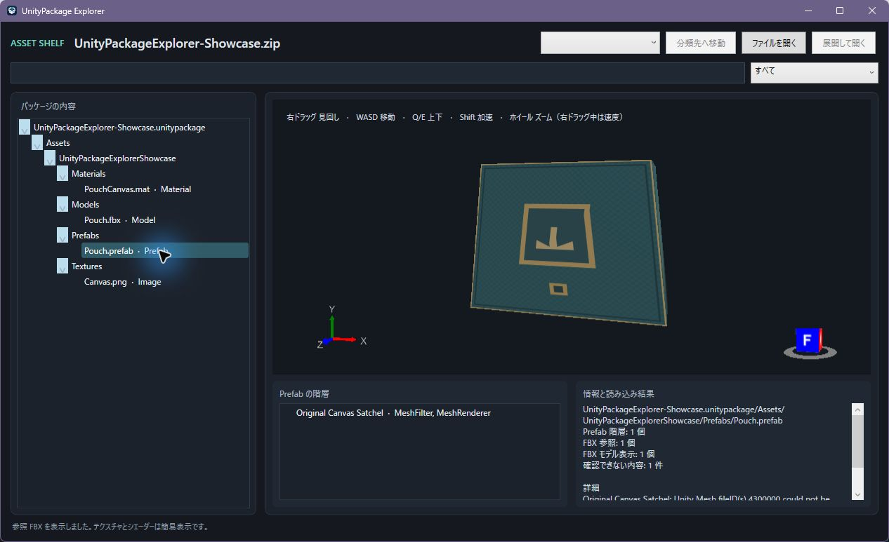

# UnityPackage Explorer

> **MotW (Mark of the Web) note:** The setup does NOT change any Windows security setting. Files downloaded from the internet (carrying MotW) cannot be previewed by Windows design. Unblock only trusted files with the included `Unblock-MotW-Folder.bat`: **copy it into the folder containing the files you want to unblock and run it** (press Enter to unblock that folder). See the "Unblocking MotW files" section below.

A Windows 11 tool to inspect UnityPackage / Prefab / FBX inside ZIP/RAR archives without launching Unity. Browse contents without extracting to decide where to organize files.

## Features

- Folder tree, search, type filtering, and image preview for `.unitypackage`.
- Inspect `.zip` / `.rar` contents without extracting; shows nested UnityPackages and loose assets.
- Automatically prioritizes the main Prefab over demos/sub-parts; switchable in the candidate list.
- Prefab hierarchy, FBX references, and basic textures.
- Lightweight preview by default; switch to lilToon-compatible view for toon shading, outlines, normals, MatCap, emission, alpha mask, and two-pass transparency.
- Rotate / zoom the 3D view; fly-through camera (standalone app).
- Drag & drop files or open via Explorer right-click.
- ZIP and single-volume RAR classification runs from the app after preview; never overwrites existing files.
- `.zip`, `.rar`, and `.unitypackage` can also be previewed in the Explorer preview pane (optional).
- UnityPackage extraction validates paths and moves into a new temp folder first.

Browsing never creates extracted files or HTML next to the original archive.



Try the [sample ZIP](tools/samples/UnityPackageExplorer-Showcase.zip) (CC0 assets).

## Install

1. Download the latest `UnityPackageExplorer-Setup-<version>-x64.exe` from [Releases](https://github.com/leva-nilla/unitypackage-explorer/releases).
2. Run the setup. The app installs per-user.
3. Enable "Add to legacy right-click menu" to get "Open with UnityPackage Explorer" under "Show more options" in Windows 11.
4. The Explorer preview pane option for ZIP, RAR, and UnityPackage is enabled by default; clear it if you do not want it. Requires .NET 10 Desktop Runtime (x64), which the setup installs from its bundled pinned installer. Preview association is per-user; COM activation info is machine-wide.
5. Open a ZIP/RAR via right-click or drag & drop. Open the Preview pane in Explorer to preview `.zip`, `.rar`, or `.unitypackage`.

The setup includes a self-contained app, a framework-dependent Explorer Preview Handler, FBX libraries, and the required Visual C++ runtime. No .NET SDK, Unity, Visual Studio, or C++ tools are required. The installer and binaries are unsigned; SmartScreen may warn — verify the source and SHA-256.

The app runs with a bundled .NET runtime. The Explorer preview uses the shared x64 .NET 10 Desktop Runtime; the setup installs a pinned, SHA-256-verified copy when it is missing and reuses an existing installation otherwise. Visual C++ runtime is deployed alongside the app.

The lilToon view requires the Microsoft Edge WebView2 Runtime (usually present on Windows 11). If unavailable, the viewer falls back to lightweight mode. Model/material/rendering code runs locally; nothing is uploaded.

Old PowerShell-based installs in the standard per-user location are upgraded in place only when their ownership marker verifies them as this product; the legacy install folder is then cleaned up. If the folder has no ownership record or contains files that cannot be verified, the setup stops to protect them. Legacy preview handler registration is removed; other file associations are untouched.

## Split RAR

Put all volumes in the same folder: `name.part1.rar`, `name.part2.rar`, … (zero padding is fine), or `name.rar`, `name.r00`, `name.r01`, …. Drag any volume into the app, or right-click a `.rar` volume to open it. The app does not join the source files on disk or move individual volumes when organizing archives.

When Explorer provides only one stream, use the app to open split RARs. Encrypted archives and repair of damaged or incomplete sets are not supported. RAR reads retain the safety limits: 2 GiB per streamed member, 512 MiB per buffered member, and 8 GiB total declared uncompressed size.

## Prefab display limitations

The screen is an approximation for asset organization. The lilToon view uses an unofficial `three-liltoon` port. Exact match with Unity's runtime lighting, physics, custom components, or full shader output is not guaranteed.

- Reads Unity text Prefab hierarchy and transforms. Binary/unparseable parts show warnings.
- Binary FBX model names are matched uniquely against Unity Mesh fileIDs to show only referenced meshes. Unsupported or unresolved identities fall back to a whole-FBX approximation with warnings.
- Text Prefab Variants and nested Prefabs are followed when resolvable; overrides are applied when renderer slots can be identified. Cycles, depth, and size limits produce warnings.
- Duplicate references to the same FBX mesh are deduplicated.
- Skinned FBX uses the Prefab root transform; individual bone deformation is not reproduced.
- FBX material names are preserved rather than merged. Explicit material-name → `.mat` remaps in `.fbx.meta` `externalObjects` are applied. Identified renderers use polygon material indices to resolve multiple slots. Nested overrides take precedence only when their renderer fileID, hierarchy and slot are unambiguous; uncertain bindings are not guessed.
- Known Standard/Lite opaque, cutout, transparent, outline variants, Hidden, and lilToonTwoPassTransparent pass values, colors, textures, and UV settings to the compatible view. Known Multi opaque/cutout/transparent modes are converted to standard rendering per official mode values; Multi-specific features may differ. Fur, refraction, gem, and tessellation families are not guessed into standard materials.
- Lightweight view approximates base color and alpha only. MatCap, outlines, and emission are omitted. Some expressions are also omitted in the compatible view due to port/GPU limits.
- If material remaps and renderer assignments cannot identify a match, Prefab colors may remain unapplied. Nested overrides whose renderer/slot cannot be identified still produce warnings; the FBX importer materials are shown instead of those overrides.
- Unsupported formats, missing references, and overly deep/cyclic hierarchies show whatever can be confirmed plus warnings.

The Explorer preview pane runs in Windows' restricted host. COM activation info is machine-wide; preview associations are per-user. The default app and UserChoice are not changed. Uninstalling or disabling the option restores prior registration values (including unset state) when they still exist.

Preview requests via COM stream create a temporary copy under LocalLow. Stream input is limited to 8 GiB; initial index and auto-preview time out at 30 s total; manual Prefab switching times out at 30 s per request. Path-based input reads the archive directly without copying.

Files downloaded from the internet may be blocked from preview by Windows (Mark of the Web). Unblock trusted files manually via right-click -> Properties -> General -> Unblock. MotW is not auto-cleared.

To unblock a folder of trusted files (elevated PowerShell):
```
Get-ChildItem -Path "C:\path\to\trusted\folder" -Recurse -File | Unblock-File
```
Only run on folders you have verified.

## Unblocking MotW files

The setup changes no Windows security settings, so newly downloaded files will keep carrying MotW and stay blocked from preview. That is by Windows design.

To preview existing MotW files, unblock only trusted ones:

- **Copy the included `Unblock-MotW-Folder.bat` into the folder containing the files you want to unblock, then run it.** When asked for a path, press Enter to unblock the folder the bat lives in (including subfolders). You may also type a folder path directly.
- For a single file: right-click -> Properties -> General -> Unblock.
- Or in elevated PowerShell:
```
Get-ChildItem -Path "C:\path\to\downloads" -Recurse -File | Unblock-File
```

Only unblock folders and files you trust. MotW marks a file's download origin; unblocked files become preview-eligible.
