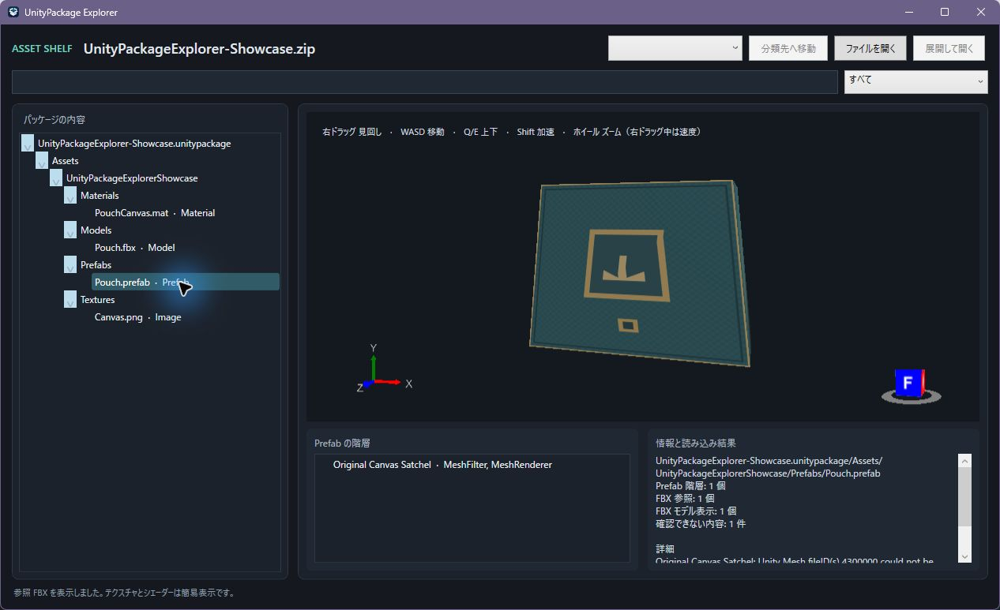

# UnityPackage Explorer

A Windows 11 tool to inspect UnityPackage / Prefab / FBX inside ZIP/RAR archives without launching Unity. Browse contents without extracting to decide where to organize files.

## Features

- Folder tree, search, type filtering, and image preview for `.unitypackage`.
- Inspect `.zip` / `.rar` contents without extracting; shows nested UnityPackages and loose assets.
- Automatically prioritizes the main Prefab over demos/sub-parts; switchable in the candidate list.
- Prefab hierarchy, FBX references, and basic textures.
- Lightweight preview by default; switch to lilToon-compatible view for toon shading, outlines, normals, MatCap, emission, alpha mask, and two-pass transparency.
- Rotate / zoom the 3D view; fly-through camera (standalone app).
- Drag & drop files or open via Explorer right-click.
- ZIP/RAR classification runs from the app after preview; never overwrites existing files.
- `.zip` / `.unitypackage` can also be previewed in the Explorer preview pane (optional).
- UnityPackage extraction validates paths and moves into a new temp folder first.

Browsing never creates extracted files or HTML next to the original archive.



Try the [sample ZIP](tools/samples/UnityPackageExplorer-Showcase.zip) (CC0 assets).

## Install

1. Download `UnityPackageExplorer-Setup-0.1.3-x64.exe` from [Releases](https://github.com/leva-nilla/unitypackage-explorer/releases).
2. Run the setup. The app installs per-user.
3. Enable "Add to legacy right-click menu" to get "Open with UnityPackage Explorer" under "Show more options" in Windows 11.
4. Optionally enable "Show ZIP / UnityPackage in Explorer preview pane". Requires .NET 10 Desktop Runtime (x64). Preview association is per-user; COM activation info is machine-wide.
5. Open a ZIP/RAR via right-click or drag & drop. Open the Preview pane in Explorer to preview `.zip` / `.unitypackage`.

The setup includes a self-contained app, a framework-dependent Explorer Preview Handler, FBX libraries, and the required Visual C++ runtime. No .NET SDK, Unity, Visual Studio, or C++ tools are required. The installer and binaries are unsigned; SmartScreen may warn — verify the source and SHA-256.

The app runs with a bundled .NET runtime. The Explorer preview uses the shared x64 .NET Desktop Runtime. Visual C++ runtime is deployed alongside the app.

The lilToon view requires the Microsoft Edge WebView2 Runtime (usually present on Windows 11). If unavailable, the viewer falls back to lightweight mode. Model/material/rendering code runs locally; nothing is uploaded.

Old PowerShell-based installs in the standard per-user location are upgraded in place. Legacy preview handler registration is removed; other file associations and user files are untouched.

## Prefab display limitations

The screen is an approximation for asset organization. The lilToon view uses an unofficial `three-liltoon` port. Exact match with Unity's runtime lighting, physics, custom components, or full shader output is not guaranteed.

- Reads Unity text Prefab hierarchy and transforms. Binary/unparseable parts show warnings.
- FBX is loaded per file. If Unity Mesh fileIDs cannot be mapped to individual FBX meshes, the whole FBX is shown as an approximation.
- Text Prefab Variants and nested Prefabs are followed when resolvable; overrides are applied when renderer slots can be identified. Cycles, depth, and size limits produce warnings.
- Duplicate references to the same FBX mesh are deduplicated.
- Skinned FBX uses the Prefab root transform; individual bone deformation is not reproduced.
- Materials are applied when names/slots can be matched; ambiguous or missing textures produce warnings.
- Known Standard/Lite opaque, cutout, transparent, outline variants, Hidden, and lilToonTwoPassTransparent pass values, colors, textures, and UV settings to the compatible view. Known Multi opaque/cutout/transparent modes are converted to standard rendering per official mode values; Multi-specific features may differ. Fur, refraction, gem, and tessellation families are not guessed into standard materials.
- Lightweight view approximates base color and alpha only. MatCap, outlines, and emission are omitted. Some expressions are also omitted in the compatible view due to port/GPU limits.
- If the FBX reference table is empty or Unity material names do not correspond to FBX material names, colors cannot be applied even when specified. Overrides whose renderer/slot cannot be identified fall back to the original FBX material.
- Unsupported formats, missing references, and overly deep/cyclic hierarchies show whatever can be confirmed plus warnings.

The Explorer preview pane runs in Windows' restricted host. COM activation info is machine-wide; preview associations are per-user. The default app and UserChoice are not changed. Uninstalling or disabling the option restores prior registration values (including unset state) when they still exist.

Preview requests via COM stream create a temporary copy under LocalLow. Stream input is limited to 8 GiB; initial index and auto-preview time out at 30 s total; manual Prefab switching times out at 30 s per request. Path-based input reads the archive directly without copying.

Files downloaded from the internet may be blocked from preview by Windows (Mark of the Web). Unblock trusted files manually via right-click -> Properties -> General -> Unblock. MotW is not auto-cleared.

## Explorer preview MotW note

To make preview work for newly downloaded files, run as Administrator:
```
reg add "HKLM\SOFTWARE\Microsoft\Windows\CurrentVersion\Policies\Attachments" /v SaveZoneInformation /t REG_DWORD /d 1 /f
```
Existing MotW files still require individual unblocking.
## MotW preview enable (optional)

Run Install-MotW.bat as Administrator to install and additionally set
HKLM\...\Policies\Attachments\SaveZoneInformation = 1, so newly downloaded
files no longer carry Mark of the Web and can be previewed.

Notes:
- This is a system-wide security setting change. Downloaded-file warnings
  will no longer appear for new files.
- Existing MotW files still require individual unblocking.
- To revert, run Uninstall-MotW.bat as Administrator.
