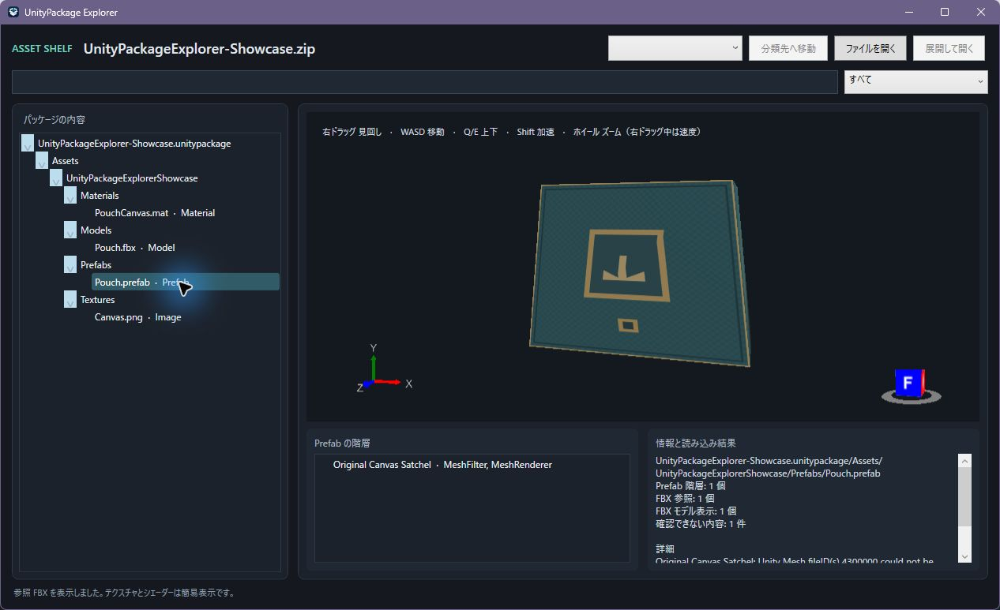

# UnityPackage Explorer

Unityを起動せずに、ダウンロードしたZIP/RARの中のUnityPackageやPrefabを確認するWindows 11向けツールです。ファイルを展開せずに内容を見て、整理先を決められます。

## 主な機能

- `.unitypackage` のフォルダー構成、検索、ファイル種類別表示、画像プレビュー。
- `.zip` と `.rar` は展開せずに中身を調べ、内包するUnityPackageとアーカイブ直下の素材を表示。
- ZIP/RAR/UnityPackageを開くとDemoや副次パーツより本体Prefabを優先して自動表示。候補欄から切り替えでき、自動表示は次回以降のために画面で切り替え可能（次期版予定）。
- `.prefab` の階層、FBX参照、基本的なテクスチャを表示。
- 3D画面をマウスで回転・拡大でき、Unityに近いフライスルー操作で移動。
- ファイルを画面へドラッグ＆ドロップ、またはエクスプローラーの右クリックから開く。
- ZIP/RARの分類はプレビュー後にアプリから実行。元アーカイブを展開せず、移動先で同名ファイルがある場合も上書きしません。
- UnityPackageを展開する場合は、パスを検証し、新しい一時フォルダーで作成してから空いている名前へ移動します。

閲覧だけでは元ファイルの隣に展開物やHTMLを作成しません。



[自作サンプルZIP](tools/samples/UnityPackageExplorer-Showcase.zip)で、ZIP内のPrefab・FBX・画像を試せます。サンプル素材はCC0です。

## インストール

1. [Releases](https://github.com/leva-nilla/unitypackage-explorer/releases) から `UnityPackageExplorer-Setup-0.1.0-x64.exe` をダウンロードします。
2. セットアップを実行します。アプリは現在のユーザーのみにインストールされます。
3. セットアップで「従来の右クリックメニューに追加」を有効にすると、ファイルの右クリック→「その他のオプションを確認」に「UnityPackage Explorer で開く」が追加されます。Windows 11の新しい右クリックメニューには登録しません。
4. ZIP/RARを右クリックして開くか、ファイルをアプリへドラッグ＆ドロップします。

セットアップにはアプリ本体、.NET 10の実行環境、FBX読込用ライブラリと必要なVisual C++ランタイムを含みます。利用者に.NET SDK、Unity、Visual Studio、C++開発ツールは必要ありません。インストーラーと実行ファイルは未署名のため、Windows SmartScreenが発行元を確認できないと表示する場合があります。配布元とSHA-256を確認してから実行してください。

.NETとVisual C++ランタイムはアプリと一緒に配置され、システム全体にはインストールされません。これらのランタイム更新は新しいアプリ版に含めて配布するため、修正を受け取るにはUnityPackage Explorerを最新版に更新してください。

旧PowerShell版が同じユーザーの標準インストール先にある場合は、その場所へ更新します。旧版のPreview Handler登録は削除し、ほかのファイル関連付けやユーザーファイルには触れません。

## Prefab表示の制約

画面は素材整理用の近似表示です。Unityのシェーダー、ライティング、物理、独自コンポーネントやUnity上の完成形は再現しません。

- Unityのテキスト形式Prefabの階層とTransformを読みます。バイナリPrefabや解析できない部分は警告を表示します。
- 参照FBXはファイル単位で読み込みます。UnityのMesh fileIDからFBX内の個別メッシュを特定できない場合は、FBX全体を近似表示します。
- 同じFBXの別メッシュを分けられない参照やネストPrefabは、重複配置を避けて省略し、画面に理由を表示します。
- スキン付きメッシュのFBX全体を表示するときはPrefabのルート位置・回転・大きさを使います。個別ボーンの配置や変形は再現しません。
- 基本の色テクスチャだけをマテリアル名とスロットから対応付けます。シェーダー固有の表現、未対応スロット、見つからない素材は表示しません。
- 次期開発版では、材質の `_Color` と識別できる opaque / transparent / cutout を読み、Helix上の簡易表示へ反映します。これは lilToon 本体の描画ではありません。未知のshader variantは不透明の近似に留めます。opaque の alpha、MatCap、outline、alpha mask などは省略し、cutout は texture alpha を二値化する近似のため深度・描画順が Unity と異なる場合があります。
- FBXの参照対応表が空、またはUnityの材質名とFBXの材質名が対応しない場合は、Prefabに色の指定があっても反映できないことがあります。ネストPrefabのRendererとスロットを特定できない上書き指定も警告し、元のFBXの材質で表示します。
- 未対応の形式、欠けた参照、循環・深すぎる階層は、確認できる範囲を表示して警告します。

エクスプローラーのプレビュー欄用Preview Handlerはこの初回版には登録しません。Windows 11の新メニュー登録も含め、専用アプリ画面からの確認を標準にします。

## アーカイブ読込みの制限

内包する `.unitypackage` は展開せずに最大 2 GiB までストリーム読込みします。これにより、以前の 512 MiB 制限で一覧すら開けなかった大きな UnityPackage も確認できます。画像などの単一素材をメモリへ読み込む際は 512 MiB、アーカイブ全体の宣言済み展開サイズは 8 GiB の安全上限を維持します。暗号化・分割・破損した RAR はパスワード入力や結合を行わず、読める範囲とエラーを表示します。

ZIP/RARとUnityPackage内部のTARは、それぞれ10万項目までです。内包UnityPackageの展開後データは合計2 GiBまで読み取ります。ソリッドRARは対象ファイルより前の内容も順に復号するため、通常のRARより待ち時間が長くなり、選択変更後の読み取り停止も遅れる場合があります。

## 右クリック項目の解除

Windowsの「設定」→「アプリ」→「インストールされているアプリ」からUnityPackage Explorerをアンインストールします。アプリが作成した右クリック項目、スタートメニューと「送る」のショートカットだけを解除します。`.zip`、`.rar`、`.prefab`、`.unitypackage` の既定アプリや、ほかのアプリの登録は変更しません。

## 開発

必要なものは.NET 10 SDK、Windows 11 x64、Inno Setup 6です。セットアップ作成ではVisual Studioのx64 Visual C++再配布ファイルを使います。

```powershell
dotnet test .\UnityPackageExplorer.sln -c Release
.\tools\release\Build-Setup.ps1 -Version 0.1.0
```

配布物は `.artifacts\release\v0.1.0` に生成されます。GitHub ActionsのWindowsジョブでもReleaseビルド、テスト、セットアップ生成を行います。

## ライセンス

プロジェクトのソースはMIT Licenseです。依存コンポーネントの著作権・ライセンスは[`THIRD-PARTY-NOTICES.md`](THIRD-PARTY-NOTICES.md)と[`ThirdPartyLicenses`](ThirdPartyLicenses/)に記載しています。
