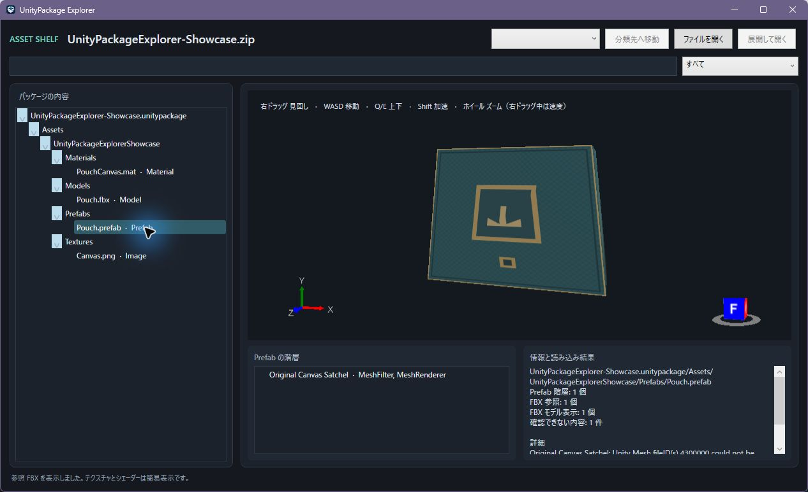

# UnityPackage Explorer

日本語 | [English](README.en.md)

**Unityを起動せずに、衣装ZIP・RARの中身を確認。**

VRChat向けの衣装を整理するときに、フォルダーへ展開せずPrefabやテクスチャを確認できる Windows 11 x64 向けの無料ツールです。別配布のマテリアルも衣装と一緒にまとめて、Unityに一度でインポートできます。

**[最新版をダウンロード](https://github.com/leva-nilla/unitypackage-explorer/releases/latest)** · [自作サンプルZIPで試す](tools/samples/UnityPackageExplorer-Showcase.zip) · [使い方](#使い方)



*スクリーンショットとサンプルZIPは[自作のCC0素材](tools/samples/README.md)を使っています。*

## できること

- **中身を探す** — ZIP・RAR内の `.unitypackage` と直収録の素材を一覧・検索。ファイル種類で絞り込めます。
- **見た目を確認する** — アプリでPrefabの3D表示や画像を確認。対応するマテリアルはlilToon互換ビューに切り替えられます。単体RAR・ZIP・UnityPackageはWindowsのプレビュー欄でも確認できます。
- **衣装とマテリアルをまとめる** — ZIPと単体RARを混ぜて統合ZIPを作成。必要なら `.unitypackage` を1つにできます。

## インストール

1. [GitHub Releases](https://github.com/leva-nilla/unitypackage-explorer/releases/latest) から `UnityPackageExplorer-Setup-<version>-x64.exe` をダウンロードして実行します。
2. 右クリックから開いたり、統合ZIPを作ったりする場合は、セットアップの「従来の右クリックメニューに追加」を有効にします。Windows 11では「その他のオプションを確認」に表示されます。
3. 最初は [自作サンプルZIP](tools/samples/UnityPackageExplorer-Showcase.zip) をアプリにドラッグ＆ドロップすると、素材一覧とPrefabの3D表示を試せます。

**必要なのは Windows 11 x64。** アプリを使うためにUnity、.NET SDK、Visual Studioを別途入れる必要はありません。セットアップは未署名です。SmartScreenの警告が出る場合は、配布元と公開されている `.sha256` を確認してください。

## 使い方

### 中身をプレビューする

| 開き方 | 対応形式・操作 |
| --- | --- |
| **アプリで開く** | `.zip`、`.rar`、`.unitypackage`、`.prefab` をドラッグ＆ドロップするか、右クリック → 「その他のオプションを確認」→「UnityPackage Explorer で開く」 |
| **エクスプローラーのプレビュー欄** | セットアップでプレビュー欄を有効にして、`.zip`、`.rar`、`.unitypackage` を選択。プレビュー欄に出ない場合は、まず専用アプリで開いてください |

アプリでは本体に近いPrefabを優先して表示し、候補欄から切り替えられます。3Dはマウスで回転・拡大でき、対応する材質は「lilToon」ボタンで互換ビューに切り替えられます。閲覧だけでは、元ファイルの横に展開物を作りません。

中身を見てからZIP・単体RARを既存の分類フォルダーへ移動したり、単体の `.unitypackage` を展開したりできます。移動先・展開先の既存ファイルは上書きしません。

### 衣装とマテリアルを1回でインポートできる形にする

1. エクスプローラーで、**同じフォルダーにあるZIP・単体RARを2つ以上**選びます。ZIPとRARは混ぜて選べます。
2. 右クリック → 「その他のオプションを確認」→ **「フォルダーにまとめて統合ZIPを作成」** を選びます。
3. フォルダー名を決めて、**「1つのUnityPackageにまとめる」** をオンにします。チェックの初期値はオフで、選んだ状態は次回も引き継がれます。
4. `指定した名前_統合.zip` の中から `指定した名前.unitypackage` を取り出し、Unityでインポートします。オフにした場合は、個々の `.unitypackage` が別々に入ります。

**元のZIP・RARは、統合ZIPの作成と検証に成功してから指定先フォルダーへ移動します。** 中身は変更しません。説明書など、元アーカイブに直接入っている `.unitypackage` 以外のファイルは元アーカイブに残ります。分割RAR、`.unitypackage` が入っていないアーカイブ、素材の衝突などがあると中止します。

一本化では素材のGUID・パス・内容を保ち、同じ素材は1件にまとめます。lilToon本体やSDKなど、元パッケージに入っていない依存関係は追加されません。

<details>
<summary>分割RARを開くには</summary>

`name.part1.rar`、`name.part2.rar` …（ゼロ埋め可）、または `name.rar`、`name.r00`、`name.r01` … を同じフォルダーに揃え、どれか1つをアプリにドラッグ＆ドロップします。`.rar` は右クリックからも開けます。

結合済みのファイルは作成しません。分割セットを崩さないよう、統合ZIPへの入力や分類移動の対象にはしていません。エクスプローラーが選択中のファイルしか渡さない場合はアプリで開いてください。暗号化RARの解除・欠けた分割ファイルの修復はできません。

</details>

## よくある質問

### Unityと同じ見た目になりますか？

プレビューは**素材を見分けるための近似表示**です。lilToon互換ビューは非公式の `three-liltoon` 移植を使い、一部の影・輪郭線・MatCap・透過などを確認できます。Unityのライティング、物理、独自コンポーネント、シェーダーの完成形は再現しません。完成形の確認や、パッケージのインポートはUnityで行ってください。

### ダウンロードしたZIPがプレビュー欄に出ません

Windowsがダウンロード由来のマーク（MotW）付きのファイルを、プレビュー欄でブロックする場合があります。**まずは専用アプリで開いてください。** このツールはMotWを自動解除せず、Windowsのセキュリティ設定も変更しません。

<details>
<summary>信頼済みのファイルだけプレビュー欄で表示する方法</summary>

配布元を確認できたファイルに限り、右クリック →「プロパティ」→「全般」→「許可する」で個別に解除できます。

セットアップに同梱の `Unblock-MotW-Folder.bat` は、指定したフォルダーの**サブフォルダーを含む全ファイル**が対象です。何も入力せずEnterを押すと、batを置いたフォルダーが対象になります。信頼性を確認できないファイルが混ざる場所では使わないでください。

</details>

### プレビュー欄やlilToon互換ビューに追加の設定は必要ですか？

- **プレビュー欄**はセットアップで無効にもできます。有効にする場合、必要な .NET 10 Desktop Runtime x64 はセットアップが同梱版を使って導入します。COM起動情報の登録に管理者確認が必要です。Runtimeが導入できない場合はプレビュー欄の登録を省略し、アプリは引き続き使えます。
- **lilToon互換ビュー**は Microsoft Edge WebView2 Runtime を使います。利用できない場合は軽量表示に戻ります。必要なら [Microsoft公式のWebView2配布ページ](https://developer.microsoft.com/microsoft-edge/webview2/) から導入してください。素材と描画はPC内で処理し、外部に送信しません。

<details>
<summary>読込み・描画の詳細と制限</summary>

- テキスト形式のPrefabの階層・FBX参照・材質を読みます。特定できるMesh fileIDや材質スロット、Prefab Variant・ネストの上書きを反映します。曖昧な参照は推測せず、警告付きでFBX全体を表示するか、該当箇所を省略します。個別ボーンの変形は再現しません。
- 軽量表示は基本色と透過の近似です。lilToon互換ビューでは対応するStandard・Lite・一部Multiなどを描画します。Fur・屈折・Gem・Tessellationなどの未対応シェーダーは近似変換しません。
- ZIP/RAR内の `.unitypackage` は1本につき最大2 GiBまでストリームで読み取ります。メモリに読み込む単一素材は最大512 MiB、外側アーカイブの宣言展開サイズは合計8 GiB、内包パッケージの展開後データは合計2 GiBです。ZIP/RARおよびTARはそれぞれ10万項目までです。
- ソリッドRARは目的のファイルより前の内容も解凍するため、通常のRARより時間がかかることがあります。
- エクスプローラーから渡されたストリームは最大8 GiBまでLocalLowに一時コピーします。最初の索引と自動プレビューは合計30秒、手動のPrefab切替は各回30秒で取消します。

</details>

<details>
<summary>アップデート・アンインストール</summary>

新しいセットアップで上書き更新できます。旧PowerShell版は、当製品のインストールと所有記録で確認できた場合だけ整理します。確認できないファイルが残る場合はセットアップが止まります。

アンインストールは Windows の「設定」→「アプリ」→「インストールされているアプリ」から行います。既定アプリやUserChoiceを変更せず、製品が設定した関連付けだけを解除・復元します。

</details>

## 開発・ライセンス

<details>
<summary>ソースからビルドする</summary>

Windows 11 x64、.NET 10 SDK、Node.js 24、Inno Setup 6、Visual Studioのx64 C++ビルド環境・再配布ファイルが必要です。

```powershell
.\tools\dependencies\Build-PatchedHelix.ps1
.\tools\release\Build-WebViewer.ps1 -Test
dotnet test .\UnityPackageExplorer.sln -c Release
.\tools\release\Build-Setup.ps1 -Version <version>
```

軽量描画に使うHelixToolkitのパッチは [`third_party/HelixToolkit.SharpDX/UPSTREAM.md`](third_party/HelixToolkit.SharpDX/UPSTREAM.md) で確認できます。セットアップは `.artifacts\release\v<version>` に生成されます。

</details>

ソースコードは [MIT License](LICENSE) です。依存コンポーネントは [Third-Party Notices](THIRD-PARTY-NOTICES.md) と [ThirdPartyLicenses](ThirdPartyLicenses/) を参照してください。
